<p align="center">
  
</p>


```asm
.include "m328Pdef.inc"

; Orlando Jared Martínez García
; Ingeniería en Teleinformática · costa del Pacífico, México
;
; Me gusta entender los sistemas desde abajo: del registro al endpoint.
; Lo construyo, lo rompo, y entiendo por qué se rompió.
```

## MAPA DE MEMORIA

```asm
.CSEG                            ; lo que ya corre en producción mental
    Java            · JavaScript    · HTML / CSS
    C / C++         · AVR Assembly

.DSEG                            ; donde guardo las cosas
    MongoDB         · MySQL

.ESEG                            ; herramientas, persisten entre reinicios
    Linux           · Git           · Docker
    Node.js         · Express       · NetBeans
```

## INICIO:

```asm
INICIO:
    RCALL  VILLAS_CANGREJO
    RCALL  HOTEL_COSTA_ALEGRE
    RCALL  QR_ASISTENCIA
    RCALL  HOLA_ORLANDO
    RJMP   INICIO                ; el ciclo nunca termina
```

<details>
<summary><b>VILLAS_CANGREJO</b> — reservaciones full-stack</summary>

<br>

Sistema completo de reservación y administración hotelera.
Cuentas de cliente, calendario de disponibilidad, panel de administrador,
reseñas de huéspedes y módulo de contabilidad.

`JavaScript` `Node.js` `Express` `MongoDB`

Lo que me dejó: modelar un dominio real donde las reglas de negocio
pesan más que el código, y manejar estado que no se puede perder.

→ [Ver repositorio](#)

</details>

<details>
<summary><b>HOTEL_COSTA_ALEGRE</b> — sitio responsivo</summary>

<br>

Sitio del Hotel Costa Alegre, proyecto de frontend universitario.
Navegación responsiva, animaciones, secciones de habitaciones,
galería de imágenes y validación de formularios.

`HTML` `CSS` `JavaScript` `Node.js`

Lo que me dejó: que un diseño que funciona en el monitor y falla en
el teléfono simplemente no funciona.

→ [Ver repositorio](#)

</details>

<details>
<summary><b>QR_ASISTENCIA</b> — registro por código QR</summary>

<br>

Aplicación de escritorio para registrar asistencia leyendo códigos QR,
con persistencia en base de datos y consulta de registros.

`Java` `MySQL` `NetBeans`

Lo que me dejó: integrar hardware de entrada con una capa de datos
sin que el usuario note la costura.

→ [Ver repositorio](#)

</details>

<details>
<summary><b>HOLA_ORLANDO</b> — scroller de siete segmentos</summary>

<br>

Texto desplazándose sobre un display de siete segmentos, escrito
directo en ensamblador sobre un ATmega328p. Sin librerías, sin
abstracciones: configuración de puertos a mano y una subrutina de
retardo con tres registros anidados.

`AVR Assembly` `ATmega328p` `5161AS`

```asm
LDI   R16, $76               ; H
OUT   PORTD, R16
RCALL RETARDO
```

Lo que me dejó: que el tiempo es un recurso que tú administras, no
algo que la máquina te regala.

→ [Ver repositorio](#)

</details>

## INTERRUPCIONES:

Lo que me saca del flujo principal ahora mismo.

```asm
.ORG  $0002
    RJMP  REDES_INALAMBRICAS     ; propagación, radioenlaces, presupuesto de enlace
.ORG  $0004
    RJMP  SISTEMAS_OPERATIVOS    ; procesos, memoria, planificación
.ORG  $0006
    RJMP  SEGURIDAD              ; reconocimiento, OSINT, superficie de ataque
```

## RETARDO:

```asm
RETARDO:
    ; Docker · Arquitectura de bases de datos · Diseño de APIs
    ; Microcontroladores más allá del ensamblador
    RET                          ; espera activa, pero con propósito
```

## FIN:

```asm
FIN:
    ;   GitHub    →  github.com/Orlandillo31
    ;   Correo    →  orlandojamaga@outlook.com
    ;   LinkedIn  →  link
    RET
```

```asm
; Hecho a mano, un ciclo a la vez.
```
