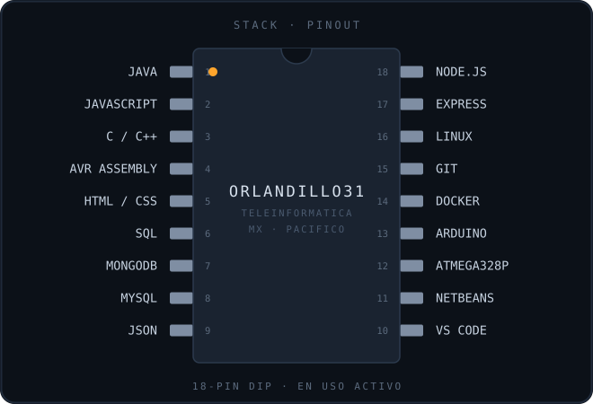

<p align="center">
  
</p>

<p align="center">
  <b>Orlando Jared Martínez García</b><br>
  Construyo sistemas y los entiendo desde abajo: del registro al endpoint.<br>
  <sub>Ingeniería en Teleinformática · costa del Pacífico, México</sub>
</p>

---

<p align="center">
  
</p>

---

## INICIO:

```asm
INICIO:
    RCALL  VILLAS_CANGREJO
    RCALL  HOTEL_COSTA_ALEGRE
    RCALL  QR_ASISTENCIA
    RCALL  HOLA_ORLANDO
    RJMP   INICIO
```

<table>
<tr>
<td width="50%" valign="top">

### Villas Cangrejo

Reservación y administración hotelera completa. Cuentas de
cliente, calendario de disponibilidad, panel de administrador,
reseñas y módulo de contabilidad.

`JavaScript` `Node.js` `Express` `MongoDB`

Aquí aprendí que las reglas de negocio pesan más que el código,
y que el estado que no se puede perder cambia todas tus decisiones.

**[Abrir repositorio →](#)**

</td>
<td width="50%" valign="top">

### Hotel Costa Alegre

Sitio del Hotel Costa Alegre. Navegación responsiva, animaciones,
secciones de habitaciones, galería y validación de formularios.

`HTML` `CSS` `JavaScript` `Node.js`

Aquí aprendí que un diseño que funciona en el monitor y falla en
el teléfono simplemente no funciona.

**[Abrir repositorio →](#)**

</td>
</tr>
<tr>
<td width="50%" valign="top">

### Asistencia por QR

Aplicación de escritorio que registra asistencia leyendo códigos
QR, con persistencia en base de datos y consulta de registros.

`Java` `MySQL` `NetBeans`

Aquí aprendí a unir hardware de entrada con una capa de datos
sin que el usuario note la costura.

**[Abrir repositorio →](#)**

</td>
<td width="50%" valign="top">

### HOLA ORLANDO

Texto desplazándose en un display de siete segmentos, escrito
directo en ensamblador. Sin librerías: puertos configurados a
mano y retardo con tres registros anidados.

`AVR Assembly` `ATmega328p` `5161AS`

Aquí aprendí que el tiempo es un recurso que tú administras, no
algo que la máquina te regala.

**[Abrir repositorio →](#)**

</td>
</tr>
</table>

---

## INTERRUPCIONES:

```asm
.ORG  $0002
    RJMP  REDES_INALAMBRICAS     ; propagación, radioenlaces, presupuesto de enlace
.ORG  $0004
    RJMP  SISTEMAS_OPERATIVOS    ; procesos, memoria, planificación
.ORG  $0006
    RJMP  SEGURIDAD              ; reconocimiento, OSINT, superficie de ataque
```

---

## RETARDO:

En progreso, con fecha y no con "aprendiendo".

- [x] Primer sistema full-stack en producción local — 2026
- [x] Primer programa en ensamblador puro sobre ATmega328p — 2026
- [ ] Contenerizar Villas Cangrejo con Docker
- [ ] Rediseñar la capa de datos con índices y migraciones
- [ ] Un proyecto de microcontrolador en C, no solo en ensamblador

---

## FIN:

```asm
FIN:
    ;   Correo    →  orlandojamaga@outlook.com
    ;   LinkedIn  →  link
    RET
```

<sub>Hecho a mano, un ciclo a la vez.</sub>
    ;   GitHub    →  github.com/Orlandillo31
    ;   Correo    →  orlandojamaga@outlook.com
    ;   LinkedIn  →  link
    RET
```

```asm
; Hecho a mano, un ciclo a la vez.
```
